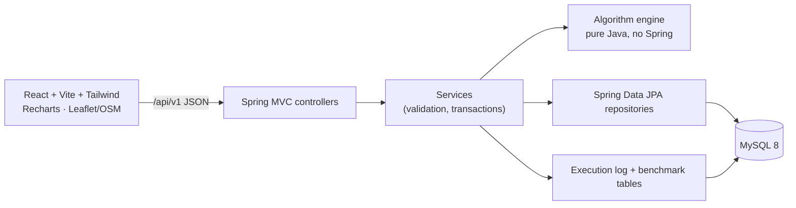

# CityShield — Intelligent Smart City Emergency Response & Resource Optimization System

B.Tech Computer Science (AI & ML) — Advanced Algorithms, CIA 3.

> **Academic simulation.** All data is synthetic. CityShield is not a live emergency-dispatch service, and its routing distances are estimates (Haversine × 1.3), not road navigation.

CityShield models a city of 50 zones, 114 roads, 18 emergency centres, 15 hospitals, 40 response teams and 1,000 incidents, and uses **ten hand-written algorithms** (no library substitutes) to prioritise emergencies, assign teams, distribute relief supplies, plan coverage and route deliveries.

## The ten algorithms

| # | Algorithm | Used for | Source (backend/src/main/java/com/cityshield/…) |
|---|---|---|---|
| 1 | Binary max-heap | Emergency priority queue | `algorithm/heap` |
| 2 | Disjoint Set Union | Road-network connectivity, isolated zones | `algorithm/dsu` |
| 3 | Segment tree | Range sums over zone inventory | `algorithm/segmenttree` |
| 4 | Trie | Zone / hospital / centre autocomplete | `algorithm/trie` |
| 5 | Knuth–Morris–Pratt | Incident text search | `algorithm/kmp` |
| 6 | Edmonds–Karp max flow | Relief-supply distribution | `algorithm/maxflow` |
| 7 | Kuhn bipartite matching | Incident-slot ↔ team assignment | `algorithm/matching` |
| 8 | Greedy set cover (+ exact) | Emergency-centre coverage | `algorithm/setcover` |
| 9 | Metric TSP 2-approximation (+ Held-Karp) | Relief delivery routes | `algorithm/tsp` |
| 10 | Randomized Quickselect | P90 high-risk threshold | `algorithm/quickselect` |

Details, complexity and tests: [`docs/ALGORITHM_DOCUMENTATION.md`](docs/ALGORITHM_DOCUMENTATION.md).

## Architecture



The frontend never implements an assessed algorithm; it only displays what the API returns. Allocation and distribution use **preview, then commit**: a preview never changes stock or team status, and the commit runs in one transaction and re-validates before writing.

## Pages (10)

Overview · Incident Management · Priority Engine · Team Allocation · Resource Distribution · City Network · Coverage Planner · Route Optimization · Algorithm Lab · Performance Analytics.

## Quick start (Windows 11)

Full instructions: [`SETUP_WINDOWS.md`](SETUP_WINDOWS.md). In short: install JDK 17, Maven, Node.js and MySQL 8, create the database and user, copy `.env.example` to `.env` and put your own password in it, then double-click `start-cityshield.bat` and open http://localhost:5173.

## Repository layout

```
backend/    Spring Boot API, algorithm engine, schema.sql, seed CSVs, JUnit tests
frontend/   React single-page app
data/       synthetic CSV data set, generators (data/tools), measured benchmark results
docs/       API, algorithm, database documentation, project report
```

## Tests and verification status

See [`docs/PROJECT_REPORT.md`](docs/PROJECT_REPORT.md) §8 for exactly what was and was not executed in the build environment.

## Security

No credentials are stored in the repository. The database password is read from the `CITYSHIELD_DB_PASSWORD` environment variable (`.env` is git-ignored; `.env.example` holds placeholders only).
