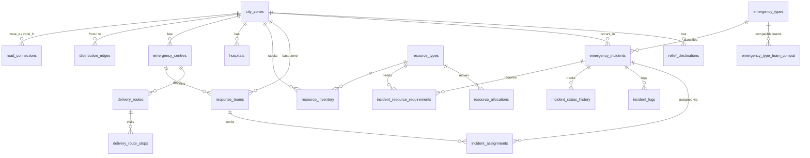

# CityShield — Database documentation

Engine: MySQL 8 (InnoDB, utf8mb4). Schema file: `backend/src/main/resources/db/schema.sql` (generated by `data/tools/generate_backend_code.py` from `data/tools/spec.py`). Tables are created with `CREATE TABLE IF NOT EXISTS`; nothing is ever dropped or altered. JPA runs with `ddl-auto=none`.

## Tables (21)

| Group | Tables | Seed rows |
|---|---|---|
| City | `city_zones` (50), `road_connections` (114), `distribution_edges` (83), `emergency_centres` (18), `hospitals` (15), `relief_destinations` (25) |
| Reference | `emergency_types` (8), `emergency_type_team_compat` (18), `resource_types` (10) |
| Operations | `resource_inventory` (500), `response_teams` (40), `emergency_incidents` (1,000), `incident_resource_requirements` (1,941), `incident_status_history` (2,881), `incident_logs` (2,996), `incident_assignments` (32) |
| Results | `resource_allocations`, `delivery_routes`, `delivery_route_stops`, `algorithm_execution_logs`, `benchmark_results` (empty until used) |

## Relationships

Constraints: every foreign key is declared; enumerated columns (status, team type, availability, road status, …) carry `CHECK` constraints; numeric ranges (severity 1–5, urgency 1–5, quantities ≥ 0) are checked in the schema and again by Bean Validation.

## Seeding
`DataSeeder` runs at start-up **only if** `cityshield.seed.enabled=true` **and** `city_zones` is empty. It loads `classpath:seed/*.csv` in foreign-key order in one transaction. Existing data is never touched. The CSVs are generated deterministically (`python data/tools/generate_dataset.py`, fixed seed); `data/synthetic/` and `backend/src/main/resources/seed/` hold identical copies. Incident timestamps end on 2026-11-15, so the dashboard's per-day chart anchors to the newest incident rather than the wall clock.

## Transactions
* Incident create/update/status change: one transaction (incident + status history + log), then the in-memory heap is synchronised.
* Team allocation commit and relief distribution commit: one transaction each; stock and team status change only on commit, and a failure rolls everything back.
* Previews are read-only.

## Reset
To reload seed data: drop and recreate the `cityshield` database yourself, then start the application. The application never does this for you.
